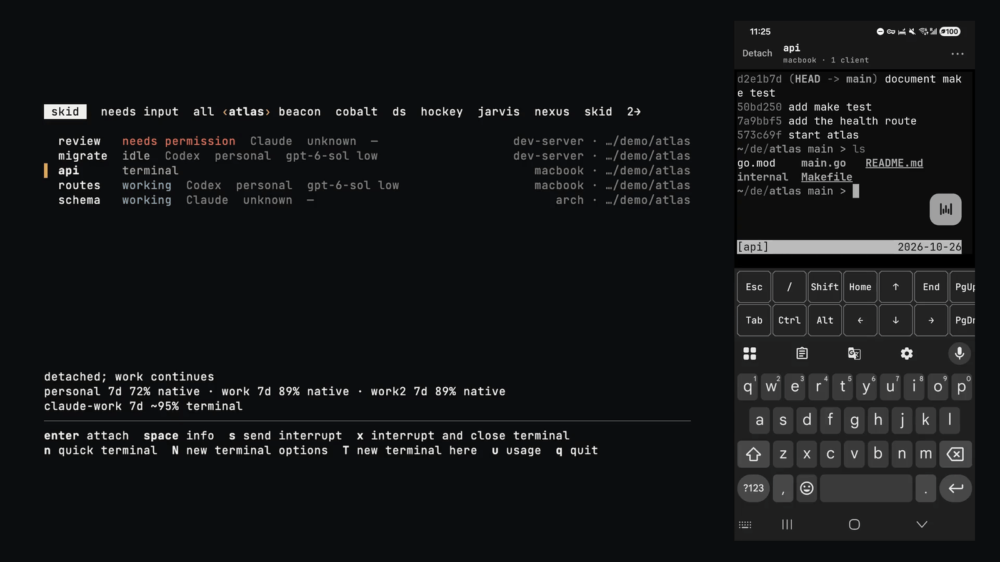

# Skíðblaðnir

Every tmux session on every machine you own, on your desktop and your Android
phone. The same live terminals, straight over your tailnet. Nothing hosted, no
skid account, nothing to migrate.

> It is so great that all the Æsir may man it, with their weapons and armaments,
> and it has a favoring wind as soon as the sail is hoisted, whithersoever it is
> bound; but … it may be folded together like a napkin and kept in one's pouch.
>
> — *Gylfaginning* 43, in Arthur Gilchrist Brodeur's 1916 translation of the *Prose Edda*

- **Room for all:** every session on every machine.
- **A fair wind wherever it's bound:** straight over your tailnet, with no relay of
  ours.
- **Folds into a pouch:** your phone.

Install skid on each of your computers and it runs a small gateway beside that
computer's tmux. The session browser (a terminal UI on any of those computers) and
the Android app list every session on every computer. From either you open a
terminal, or an agent such as Codex or Claude Code, and attach to the same live
terminal the other sees; detach, and the work keeps running in tmux. The phone is
a terminal, not a chat view. skid itself hosts nothing and has no account;
Tailscale needs an account, and may carry traffic through its encrypted DERP
relays when no direct path exists.

Skíðblaðnir is a single-user prototype, built and run by one person
([calibration](docs/architecture.md)).

[](site/assets/continuity.mp4)

## Requirements

| | Mac | Linux | Phone |
| --- | --- | --- | --- |
| System | macOS 26 or later, Apple silicon | Ubuntu 24.04 or later, or Arch Linux or a derivative; amd64; systemd | Android 13 or later |
| Needed first | Homebrew | curl, sudo | Google Play services |
| Shell | bash or zsh | bash or zsh | |
| For remote use | Tailscale, with MagicDNS and HTTPS certificates on | the same, with you as Tailscale's operator | the Tailscale app, on the same tailnet |
| Optional | Codex, Claude Code | Codex, Claude Code | push through your own Firebase project |

Ubuntu derivatives and Debian are refused; an Arch derivative qualifies when its
`/etc/os-release` lists `arch` in `ID_LIKE`. The phone pairs only by scanning a QR
code with Google Play services.

## Install

| Platform | The installer adds, when missing | Then, by hand |
| --- | --- | --- |
| macOS | tmux and the Tailscale app, through Homebrew; Homebrew's `openssl@3` when the system OpenSSL cannot check the signature | approve Tailscale's system extension and sign in |
| Ubuntu | tmux, through apt; Tailscale, through Tailscale's own installer | sign in to Tailscale; `sudo loginctl enable-linger $(id -u)`, or logging out stops skid and its sessions |
| Arch and derivatives | tmux and Tailscale, through pacman, which asks on your terminal | `sudo systemctl enable --now tailscaled`; sign in; linger, as on Ubuntu |
| Android | | install `skidbladnir-android.apk` from the same release, or track releases with [Obtainium](docs/phone.md#obtainium) ([phone](docs/phone.md)) |

The installer is a short Bash script that carries the release signing key,
downloads this computer's archive, checks its signature and hands off to the
archive's `skid install`. Read it first:

```sh
curl -fsSLO https://github.com/NielsdaWheelz/skidbladnir/releases/latest/download/install
less install
bash install
```

Or, having read it:

```sh
curl -fsSL https://github.com/NielsdaWheelz/skidbladnir/releases/latest/download/install | bash
```

`bash install v0.23.0` installs a given release. The installer links
`~/.local/bin/skid`, puts `~/.local/bin` on `PATH` through marked blocks in your
shell startup files, writes a default `config.yaml` once and starts skid's
services. Updates are manual: `skid update` on each computer, and a new APK on the
phone. `skid uninstall` turns off Tailscale Serve on port 8443 and removes skid,
keeping settings, private state, sessions, tmux and Tailscale.
[Install](docs/install.md) has every step.

## Quickstart

1. Install skid on your first computer. It takes its hostname as its name and
   becomes the hub of a new fleet. On a fresh computer the installer ends with:

   ```
   installed v0.23.0; settings and private state preserved
   local shells need no provider or tailscale login
   new login and interactive shells find skid; in this one, run: export PATH="$HOME/.local/bin:$PATH"
   ```

2. Run `skid` to open the session browser. `n`, then `enter`, opens a terminal in
   your home directory; `ctrl-]` then `d` detaches, and it keeps running in tmux.
   `q` quits; `skid help browser` lists every key.

3. To start agents too, list them as profiles in the hub's
   `${XDG_CONFIG_HOME:-~/.config}/skidbladnir/config.yaml` and run `skid apply`;
   `N` in the browser then offers them. Each command runs after your shell's
   normal startup, so your aliases apply
   ([every field](docs/architecture.md#5-configuration)).

   ```yaml
   version: 1
   profiles:
     - name: codex
       command: codex
       provider: codex
     - name: claude
       command: claude
       provider: claude
   ```

4. For remote use, sign in to Tailscale on the hub and turn on MagicDNS and HTTPS
   certificates on Tailscale's [DNS page](https://login.tailscale.com/admin/dns);
   on Linux, also run `sudo tailscale set --operator=$USER`. Then `skid connect`
   checks all of that, points Tailscale Serve's HTTPS port 8443 at the gateway
   (replacing whatever it served) and prints a QR code and an invitation:

   ```
   skid://connect/…
   scan with skid on your phone, or paste into skid join on another computer; expires in five minutes
   ```

5. On the phone, install Tailscale and sign in to the same tailnet. Install the
   skid APK ([phone](docs/phone.md)), open it, tap Connect and scan the code.

6. To add a computer, install skid there and sign in to Tailscale. Paste an
   invitation from `skid connect` on any computer in the fleet into `skid join` on
   the new one, with `--name NAME` if the fleet already has its hostname. Then run
   `skid connect` once on the new computer so that it serves port 8443 too, and
   ignore its invitation. `skid status` on the hub lists the fleet (IDs shortened;
   tailnet names replaced with `example.ts.net`):

   ```
   fleet 8e1ab1ff…; service v0.23.0
   device       kind      name        version  origin                                  configuration
   d-2b420089…  hub       dev-server  v0.23.0  https://dev-server.example.ts.net:8443  applied
   d-93212829…  computer  macbook     v0.23.0  https://macbook.example.ts.net:8443     applied
   d-d93a050b…  computer  arch        v0.23.0  https://arch.example.ts.net:8443        applied
   d-7d0bc523…  phone
   ```

## How it works

```text
      phone, or skid on another computer
             /                       \
    https :8443 on your tailnet    https :8443 on your tailnet
           /                           \
  laptop: skid serve (hub)        server: skid serve
           |                             |
          tmux                          tmux
```

Each computer runs one gateway, `skid serve`, as a systemd user service or a
macOS launch agent. It listens on `127.0.0.1:7341`, controls only its own
computer's tmux, and reaches your tailnet through Tailscale Serve. Clients call
each gateway directly; no computer relays another's terminal.

The hub is the control plane: the first computer installed, or the last to run
`skid recover`. It holds membership, the accepted `config.yaml` and notification
state, and it issues invitations. tmux is the data plane: it owns every session
and process, and skid keeps no session database. Lose the hub, keep the shells:
every computer caches the membership, so its terminals stay reachable, and only
edits, new devices, removals and notifications wait for the hub, or for
`skid recover` on another computer
([fleet operations](docs/architecture.md#fleet-operations)).

Every action targets one exact tmux session and is attempted at most once; a lost
reply is reported as unknown, never retried. Agent status, read from the screen,
is evidence for you, never authority for an action.

## When not to use skid

- You use an iPhone. There is no iOS app.
- Your computers run Windows, macOS before 26 or on an Intel processor, or Linux on
  arm64.
- You are a team. A fleet has one owner, and every device in it can open a shell on
  every computer.
- You don't use Tailscale, or you want a hosted relay.
- You want a chat interface to your agents. The phone shows their terminals.

## Reading the code

Start with the [architecture](docs/architecture.md): the contract and the five
constraints most mechanisms follow from. The [reading path](docs/codebase-map.md#reading-path)
is eight files that carry those ideas into code; the [history](docs/history.md)
gives each decision with the constraint that forced it and its cost; the
[design language](docs/design-language.md) gives the look and its sources.

The host is Go (`cmd/skidbladnir`, `internal/`): `go build -o skid ./cmd/skidbladnir`
with the toolchain `go.mod` names, plus the Xcode command-line tools on macOS. The
phone is Kotlin, Jetpack Compose and xterm.js (`android/`). `scripts/check verify`
runs the engineering checks. There is no retained behavioral test suite: each
change is proven by temporary tests at its boundary, then deleted
([why](docs/history.md#5-temporary-tests-over-a-retained-suite)).
`release-pin.json` pins the published release's version, source commit and asset
digests, and `scripts/check published-release TAG SOURCE_SHA` checks the public
release against it.

## Where to go next

| To | Read |
| --- | --- |
| Install on a computer, step by step | [Install](docs/install.md) |
| Install, verify and update the phone app, or set up push | [Phone](docs/phone.md) |
| Look up a command | `skid --help` and `skid help COMMAND` |
| Configure profiles, the shell and defaults | [Architecture §5](docs/architecture.md#5-configuration) |
| Understand the trust model or report a vulnerability | [Security](SECURITY.md), [architecture §3](docs/architecture.md#3-topology-and-trust) |
| Report a bug | [Contributing](CONTRIBUTING.md) |
| Understand how it is built, and why | [Architecture](docs/architecture.md), [history](docs/history.md) |
| Find any other document | [Docs index](docs/README.md) |

## FAQ

**What does the name mean?** Skíðblaðnir (SKEETH-blahth-neer). Call it skid. In
the *Prose Edda* it is Freyr's ship, made by dwarves, the sons of Ívaldi: big
enough for all the gods, and folded into a pouch when it is not at sea. Dwarves
built the ship, and in skid dwarves crew it. On the phone each session is a dwarf,
with a name and a seal from a catalogue of 101 drawn from Norse myth, Tolkien and
Wagner.

**How does it compare?** Remote access to coding agents sorts on three questions:
who carries the bytes, who owns the process, and what the phone shows. skid
answers your tailnet, your tmux, and a terminal.

- herdr, with droidtty on Android: the most capable agent-aware multiplexer, and a
  native Android client for it. skid keeps tmux as the owner of your sessions, so
  nothing migrates and sessions outlive skid.
- Claude Code Remote Control and Codex remote: free and first-party; traffic goes
  through the vendor; one provider each, in a conversation view.
- T3 Code and Happy: polished multi-provider phone apps, with their own server or
  relay and a conversation view.
- Termius or Moshi with tmux: no new software on the host; one host at a time.

**Does it know what my agents are doing?** It recognizes Codex and Claude Code in
a terminal's foreground and infers from the screen whether each is working, idle
or waiting for you. The hub notifies you when one needs input or is ready again:
on a Mac through skid's notification app, and on Android, in the background, only
with [push](docs/phone.md#push-notifications-optional) through your own Firebase
project.

**Can scripts and agents drive it?** Yes. `skid list --json`, `read`, `send`,
`wait` and the rest reach every computer in the fleet, and `skid --help` includes
an automation guide. So an agent that can run skid can drive every terminal in the
fleet ([security](SECURITY.md)).

**How do I revoke a lost phone?** On any computer in the fleet, `skid status`
lists its device ID and `skid remove DEVICE_ID` revokes it
([security](SECURITY.md)).

**What does skid send over the network?** Your devices reach each other only over
your tailnet. A computer contacts GitHub to install or update, and its package
manager or Tailscale's installer when tmux or Tailscale is missing. Android push,
if you set it up, goes through Google, and the phone scans its pairing code with
Google Play services. skid has no telemetry, and its logs hold no terminal
content.

## License

Copyright 2026 Niels-Erik Nandal. Licensed under the [Apache License, Version
2.0](LICENSE). The bundled fonts (SIL Open Font License 1.1) and xterm.js (MIT)
keep their own licenses, which ship beside them in
[`android/app/src/main/assets/licenses`](android/app/src/main/assets/licenses) and
[`android/app/src/main/assets/terminal/vendor`](android/app/src/main/assets/terminal/vendor).
